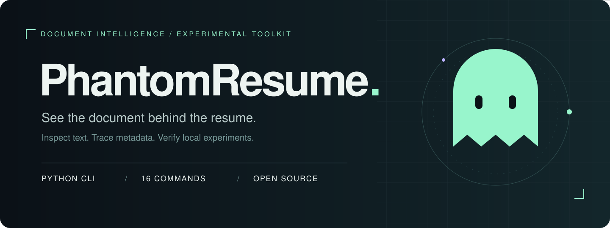
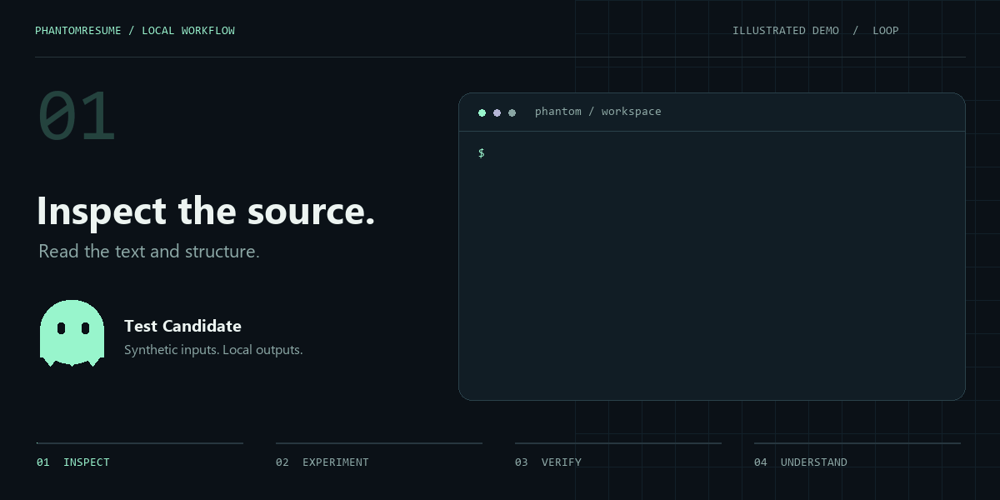

<p align="center">
  
</p>

<p align="center">
  <a href="https://github.com/ansh2807/phantom-resume/actions/workflows/checks.yml"></a>
  
  <a href="LICENSE"></a>
  
</p>

<p align="center">
  <b>Inspect. Understand. Experiment. Verify.</b><br />
  Explore resume text, document metadata, and experimental prompt-injection channels from one CLI.
</p>

<p align="center">
  <a href="#quick-start">Quick start</a> ·
  <a href="#the-toolkit">Features</a> ·
  <a href="docs/COMMANDS.md">Commands</a> ·
  <a href="docs/FEATURES.md">Module guide</a> ·
  <a href="docs/LIMITATIONS.md">Known limits</a>
</p>

---

## A look inside

<p align="center">
  
</p>

<p align="center"><sub>Illustrated workflow, not a live ATS result. <a href="assets/workflow-still.png">View the static version</a>.</sub></p>

PhantomResume is a Python toolkit for inspecting resumes and studying how document content moves through parsers. It includes rewrite suggestions, DOCX experiments, PDF export, HTML reports, media metadata tools, and read-only browser probes.

**Experimental research software.** An injected string appearing in a local file does not prove that an ATS reads it, follows it, or changes a hiring decision. Scores and channel weights are heuristics. Use synthetic documents and systems you control or have permission to test.

## Quick start

```bash
git clone https://github.com/ansh2807/phantom-resume.git
cd phantom-resume
python -m venv .venv
```

Activate the environment:

```powershell
# Windows PowerShell
.venv\Scripts\Activate.ps1
```

```bash
# macOS / Linux
source .venv/bin/activate
```

```bash
python -m pip install -r requirements.txt
python examples/create_demo.py
python phantom_resume.py analyze demo-output/test-candidate.docx
python phantom_resume.py inspect demo-output/test-candidate.docx
python phantom_resume.py improve demo-output/test-candidate.docx
```

The demo generator creates a **fictional Test Candidate**, a sample job description, and a generated image. No real candidate files are included in this repository.

<details>
<summary><b>Optional system dependencies</b></summary>

- Browser probes: `python -m playwright install chromium`.
- QR decoding on Debian/Ubuntu: `sudo apt-get install libzbar0`.
- QR decoding on macOS: `brew install zbar`.
- Word-based PDF conversion requires Microsoft Word and a supported Windows/macOS environment. Otherwise, the exporter uses ReportLab and reconstructs the layout.
- Windows consoles: use `python -X utf8` if Unicode symbols do not display correctly.

</details>

## The toolkit

| Area | Included features | Entry points |
| :--- | :--- | :--- |
| **Resume review** | Parsing, heuristic scores, issue detection, rewrite suggestions | `analyze`, `improve`, `inspect` |
| **Document experiments** | Metadata, hidden text, comments, Unicode, headers, fields, split and encoded payloads | `inject`, `deep`, `stealth` |
| **Media channels** | Image metadata, alt-text, QR codes, audio metadata, embedded fonts | `core/*_injector.py` |
| **Output** | DOCX copies, PDF export, HTML reports, batch processing, ZIP-part diffs | `full`, `batch`, `diff`, `--pdf` |
| **Cover letters** | Resume/JD templates and optional DOCX injection | `cover` |
| **ATS tooling** | URL fingerprinting, extraction signatures, configurable heuristic weights | `ats`, `tuning`, extraction API |
| **Browser inspection** | Greenhouse/Lever form discovery without filling, uploads, or submission | `probe --probe-only` |
| **Experiment records** | A–D payload variants and local SQLite outcome tracking | `track`, `notes` |
| **Advanced modules** | Eight languages, LSB encoding, script variants, custom fonts, DOCX merging, template seeds | Python API; [module guide](docs/FEATURES.md) |

All source modules are included. Some advanced features are Python APIs rather than CLI switches; preservation of a module is not a claim of end-to-end validation.

## Run a local document experiment

```bash
# Create a separate experimental copy; the original is retained.
python phantom_resume.py inject demo-output/test-candidate.docx --mode aggressive --output demo-output/test-candidate-injected.docx --pdf

# Inspect the local result and compare embedded image pixels.
python test_all_injections.py demo-output/test-candidate-injected.docx
python test_images.py demo-output/test-candidate-injected.docx --original demo-output/test-candidate.docx
python phantom_resume.py diff demo-output/test-candidate.docx demo-output/test-candidate-injected.docx

# Generate an HTML report with the full local workflow.
python phantom_resume.py full demo-output/test-candidate.docx --mode aggressive --output-dir demo-output/full
```

| Mode | Channels selected by the resume pipeline |
| :--- | :--- |
| `safe` | Core metadata only. **This still injects instructions**; it is not a guarantee of safety. |
| `aggressive` | Metadata, hidden runs, comments, zero-width text, QR, image metadata and alt-text. |
| `nuclear` | Aggressive channels plus headers/footers, fields, split payloads, Base64, acrostics, recruiter-note text, whitespace, and audio/font handlers. |

`stealth` selects a randomized channel subset. Different file hashes demonstrate different bytes, not undetectability.

## Cover letters and read-only probes

```bash
python phantom_resume.py cover demo-output/test-candidate.docx --jd demo-output/job-description.txt --output demo-output/cover.txt

# Replace the URL with a portal you are authorized to inspect.
python phantom_resume.py probe greenhouse demo-output/test-candidate.docx --url https://your-authorized-test-board.example --probe-only
```

`--probe-only` stops before filling fields, attaching a file, or clicking Submit. It can verify form discovery; it cannot verify what an ATS extracts. **Without that flag, the legacy probe can attempt an application submission.** Its substring-based demo URL check does not establish ownership or authorization. See [probe limitations](docs/LIMITATIONS.md#browser-probes) before using that path.

Review generated cover letters: extraction is heuristic, and fallback accomplishments are not verified facts.

## Verify the code

```bash
python -m unittest discover -s tests -v
```

The automated suite uses synthetic documents and mocked browser interactions. It checks document generation, metadata, PDF counters, local extraction, and the no-fill/no-upload/no-submit path. CI does not contact job portals or submit applications.

The legacy `test_all_injections.py` verifier is also included. Its total depends on which media exist in a document. A passing count is not an ATS benchmark. [Read the validation scope](docs/LIMITATIONS.md).

## Project map

```text
phantom-resume/
├── phantom_resume.py       CLI
├── core/                   All analysis, injection, export and ATS modules
│   └── ats_probes/          Greenhouse / Lever browser adapters
├── examples/               Synthetic fixture generator
├── tests/                  Offline regression checks
├── scripts/                README artwork generator
├── docs/                   Commands, module guide and known limits
├── assets/                 Hero, animated walkthrough and report styles
└── .github/workflows/      Offline CI
```

## Privacy by default

The public repository contains source code, documentation, and synthetic artwork. Candidate resumes, PDFs, screenshots, submission logs, databases, local paths, and tuned runtime state are excluded. Generated documents and common private artifacts are ignored by Git. Review `git diff --cached` before sharing changes; ignore rules are not a substitute for a content review.

## Contributing

See [CONTRIBUTING.md](CONTRIBUTING.md). Reproduce issues with synthetic fixtures and include the command, platform, and traceback. Keep candidate information and credentials out of issues and pull requests.

<p align="center"><sub>Built for transparent document experiments. Licensed under <a href="LICENSE">MIT</a>.</sub></p>
