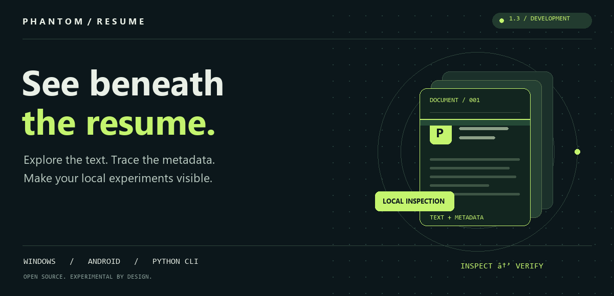
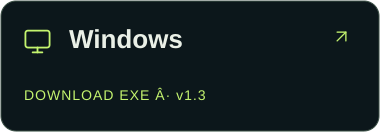
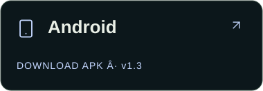
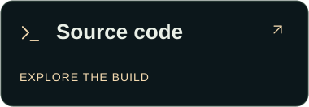
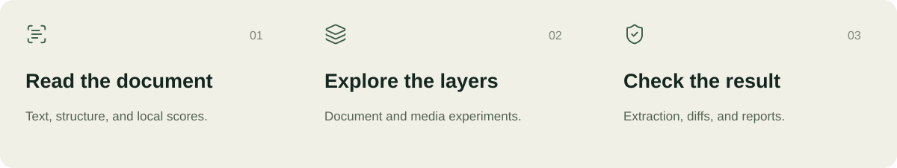
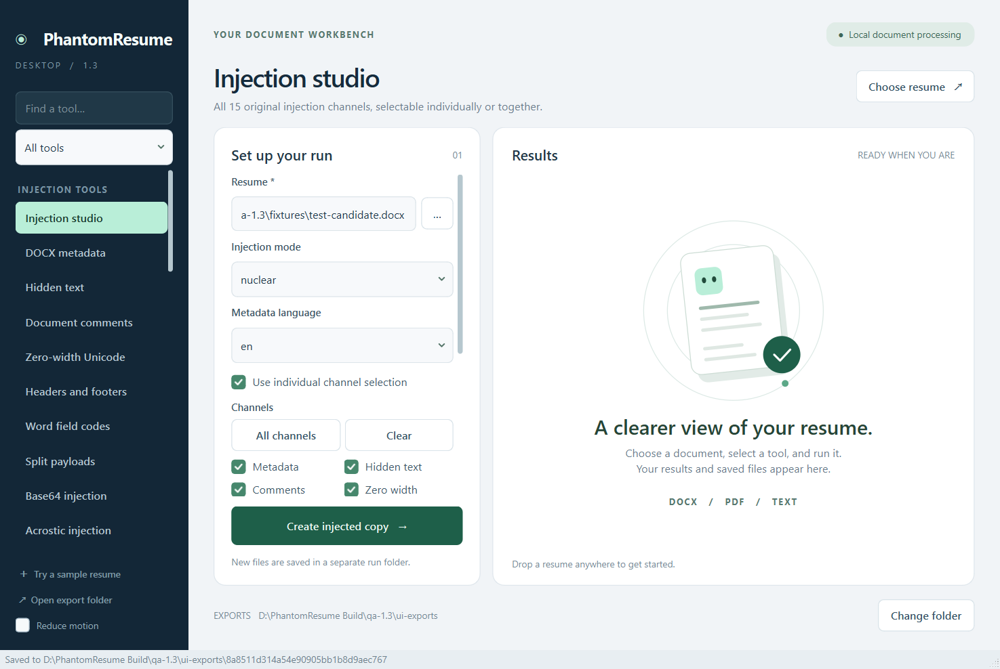

<p align="center">
  <picture>
    <source media="(prefers-reduced-motion: reduce)" srcset="assets/brand/cover.png" />
    
  </picture>
</p>

<h1 align="center">PhantomResume</h1>
<p align="center"><b>Your document. Every layer. One workbench.</b><br />
Resume analysis, experimental prompt injection, media inspection, and local verification.</p>

<p align="center">
  <a href="https://github.com/ansh2807/phantom-resume/actions/workflows/checks.yml"></a>
  <a href="https://github.com/ansh2807/phantom-resume/releases/tag/v1.3.0"></a>
  
  <a href="LICENSE"></a>
</p>

<p align="center">
  <a href="#get-the-app">Download</a> &nbsp; / &nbsp;
  <a href="#inside-the-workbench">Explore</a> &nbsp; / &nbsp;
  <a href="#start-with-a-synthetic-resume">Quick start</a> &nbsp; / &nbsp;
  <a href="#tested-with-boundaries">Verification</a> &nbsp; / &nbsp;
  <a href="docs/COMMANDS.md">Documentation</a>
</p>

<p align="center"><sub>Prefer no motion? <a href="assets/brand/cover.png">Open the still cover</a>.</sub></p>

## Get the app

<p align="center">
  <a href="https://github.com/ansh2807/phantom-resume/releases/download/v1.3.0/PhantomResume.Desktop.exe"></a>
  <a href="https://github.com/ansh2807/phantom-resume/releases/download/v1.3.0/PhantomResume.Android.apk"></a>
  <a href="https://github.com/ansh2807/phantom-resume/tree/main/apps"></a>
</p>

**[Windows EXE](https://github.com/ansh2807/phantom-resume/releases/download/v1.3.0/PhantomResume.Desktop.exe)** · **[Android APK](https://github.com/ansh2807/phantom-resume/releases/download/v1.3.0/PhantomResume.Android.apk)** · [Release notes & checksums](https://github.com/ansh2807/phantom-resume/releases/tag/v1.3.0)

Windows x64 · Android 8+ / ARM64 and x86_64 · No separate Python installation for the apps.
The Windows build is unsigned; the APK is signed with the project's local release key.

> [!IMPORTANT]
> **Development release, not a hiring shortcut.** Local extraction shows what survives a parser—not what an ATS will do with it. No live screening effectiveness is established. Use synthetic documents and systems you control or have permission to test.

## Inside the workbench



| Review & create | Experiment & inspect | Verify & export |
| :--- | :--- | :--- |
| Resume parsing and heuristic scores | 15 selectable original injection channels | Extracted text and metadata |
| Issues and rewrite suggestions | Image, audio, QR and embedded-font metadata | DOCX comparisons and HTML reports |
| Cover-letter templates | Deep metadata, encodings and variants | PDF export and batch processing |
| Local outcome journal | Read-only public-page inspection | Seven local addon smoke checks |

**38 app tools**, with dedicated controls for the original injection channels.
Some channels require existing images, audio, fonts, headers, or footers; absent parts may be skipped.
[Explore the module guide →](docs/FEATURES.md)

<details open>
<summary><b>See the Windows workbench</b> — actual 1.3 synthetic test session</summary>

<p align="center"></p>

The app writes separate result folders and keeps original input files unchanged.
Workers run on demand; cancellation and closing behavior are covered by the app acceptance checks.

</details>

<details>
<summary><b>Watch the illustrated workflow</b></summary>

<p align="center"></p>

Illustration, not live ATS footage. [Static version](assets/workflow-still.png).

</details>

## Tested, with boundaries

| Evidence | Passing cases | What the number covers |
| :--- | ---: | :--- |
| **Windows 1.3** | **78** | Packaged acceptance, UI, cancellation, worker/browser shutdown |
| **Android 1.3** | **40** | Synthetic tool checks on ARM64; in-place update and Back-to-close checked separately |
| **Historical source audit** | **166** | Recorded original-project cases; **7 not run**; not rerun against these apps |

These counts overlap in scope and **must not be added together**. They count cases, not independently verified features.
[Build reports, hashes, and exact limits →](docs/releases/1.3.0/README.md)

<details>
<summary><b>What remains unverified or unfinished?</b></summary>

- The addon API configures **no document channels**. Manifest/tracker success does not establish document payload recovery.
- Four planned modules remain unimplemented: acrostic verbs, synonym sets, attention path, and calibrator.
- No live ATS submissions or screening success were tested.
- Word COM, LibreOffice rendering, and every possible media/file variant are not covered by this audit.
- WebM metadata appears as `MOVIE/TITLE` with the tested parser; the separate lowercase `title` check fails.
- Android x86_64 is packaged but was not device-tested in this update.
- Code compilation and obfuscation do not make the apps impossible to reverse engineer.

[Complete limitations](docs/LIMITATIONS.md) · [Historical source report](docs/releases/1.3.0/SOURCE-AUDIT.md)

</details>

## Start with a synthetic resume

```bash
git clone https://github.com/ansh2807/phantom-resume.git
cd phantom-resume
python -m venv .venv
```

Activate with `.venv\Scripts\Activate.ps1` on Windows, or `source .venv/bin/activate` on macOS/Linux. Then:

```bash
python -m pip install -r requirements.txt
python examples/create_demo.py
python phantom_resume.py analyze demo-output/test-candidate.docx
python phantom_resume.py inspect demo-output/test-candidate.docx
```

The generator creates a fictional **Test Candidate**. No real candidate documents are included.

[Full CLI walkthrough](docs/CLI-WALKTHROUGH.md) · [Command reference](docs/COMMANDS.md) · [Optional dependencies](docs/CLI-WALKTHROUGH.md#quick-start)

<details>
<summary><b>Injection modes & browser boundaries</b></summary>

| Mode | Selected behavior |
| :--- | :--- |
| `safe` | Core metadata instructions. The name is **not a safety guarantee**. |
| `aggressive` | Metadata, hidden runs, comments, zero-width text, QR and image metadata. |
| `nuclear` | Additional fields, header/footer handlers, encodings, recruiter-note fixtures and audio/font handlers. |

`stealth` randomizes a subset; different bytes do not prove undetectability.
For CLI browser inspection, use `--probe-only`. **Without that flag, the legacy probe can attempt submission.** Its demo-URL check does not establish authorization. [Read the probe limits](docs/LIMITATIONS.md#browser-probes).

</details>

## Find your way around

| Destination | Start here |
| :--- | :--- |
| **Use the CLI** | [Commands](docs/COMMANDS.md) · [Walkthrough](docs/CLI-WALKTHROUGH.md) |
| **Build the apps** | [Windows](apps/windows/README-DESKTOP.md) · [Android](apps/android/README.md) |
| **Explore the source** | [Core](core/) · [Payloads](payload/) · [Channels](channel/) · [Orchestration](orchestration/) |
| **Check the evidence** | [Release verification](docs/releases/1.3.0/) · [Offline tests](tests/) · [CI](https://github.com/ansh2807/phantom-resume/actions) |
| **Contribute** | [Contributor guide](CONTRIBUTING.md) · [Report an issue](https://github.com/ansh2807/phantom-resume/issues) |

Run offline regressions with `python -m unittest discover -s tests -v`.
They use synthetic documents and mocked browser interactions, not job submissions.
Keep personal resumes, credentials, and application records out of issues and commits.

<p align="center"></p>

<p align="center"><a href="LICENSE">MIT licensed</a> · <a href="assets/brand/ATTRIBUTION.md">Artwork & icon credits</a> · <a href="https://github.com/ansh2807">Built by ansh2807</a><br /><sub>If the project helps your experiments, a star helps other builders find it.</sub></p>
